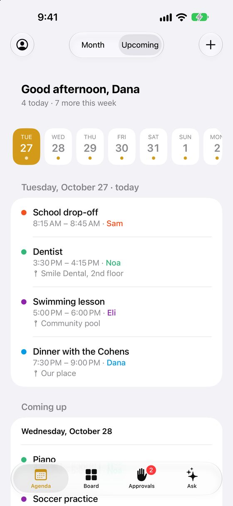
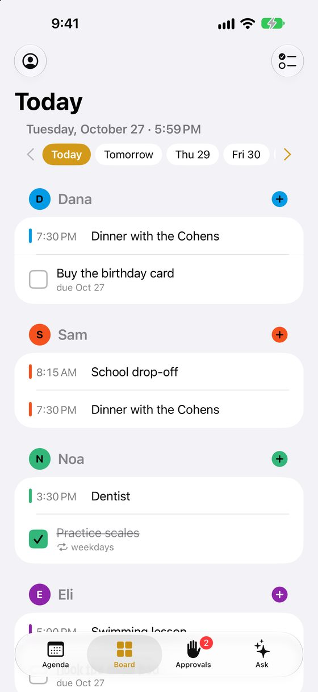
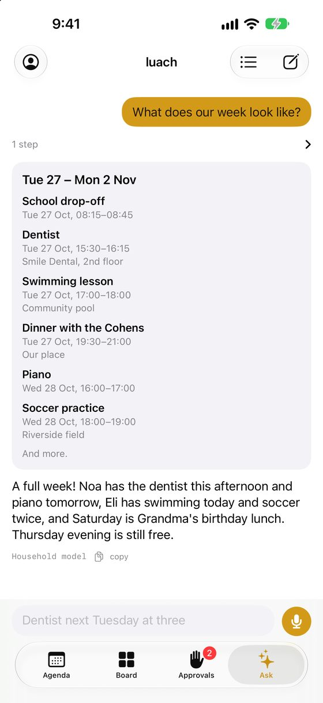
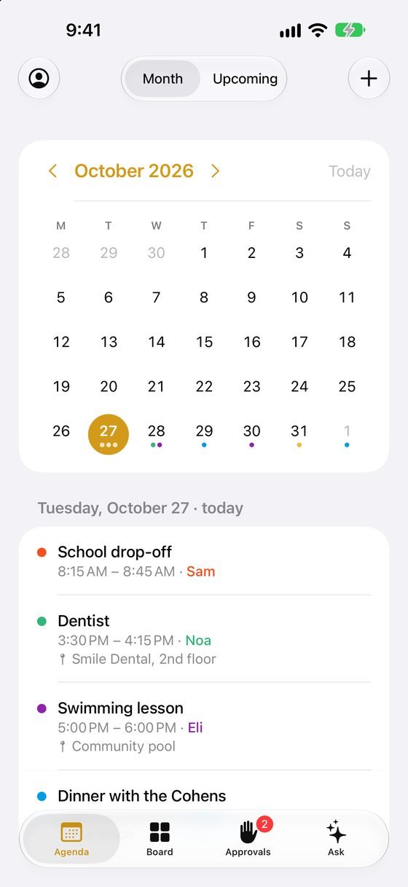
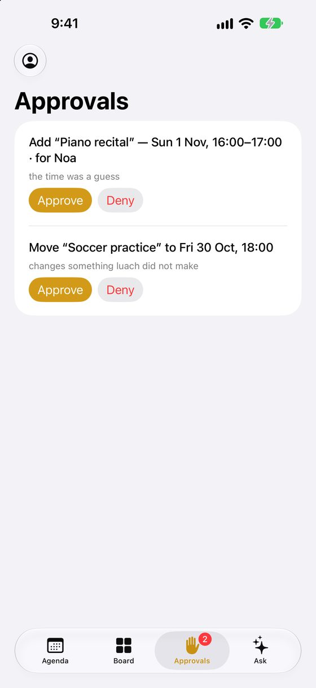
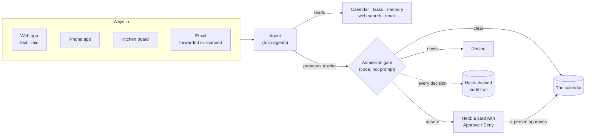
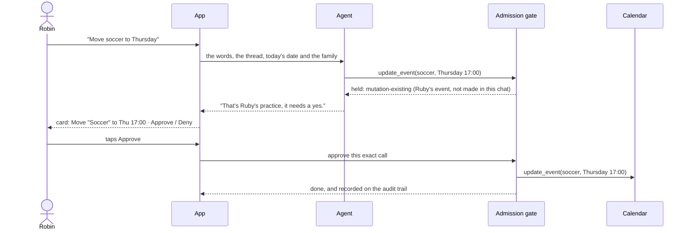
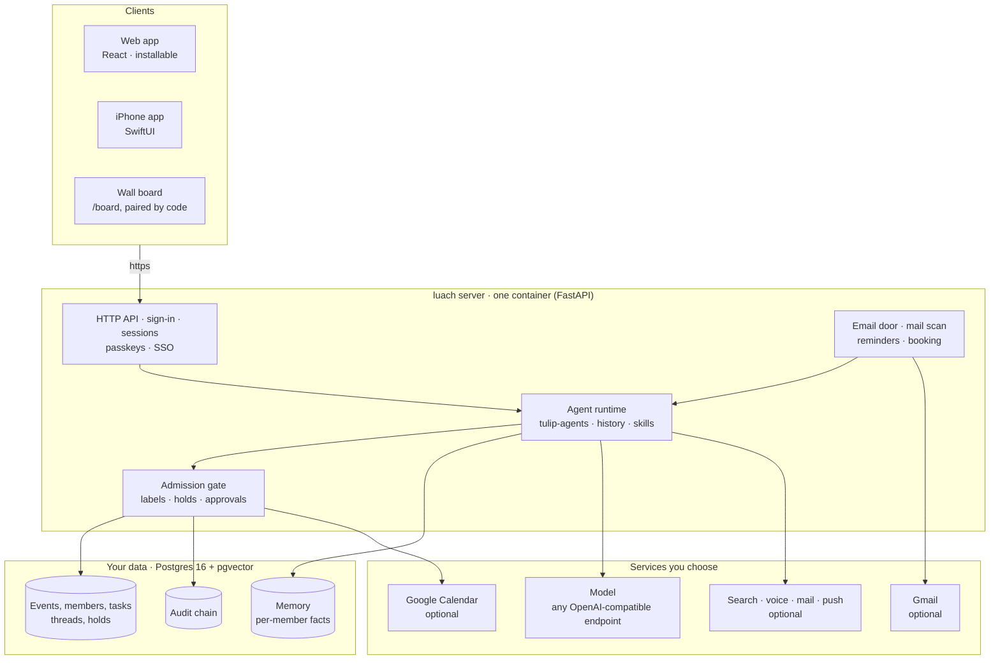

<p align="center"></p>

<h1 align="center">luach · לוח</h1>

<p align="center"><b>A family calendar you can talk to, run by a governed agent, on your family's own server.</b></p>

<p align="center">
  <a href="https://github.com/luach-app/luach/actions/workflows/ci.yml"></a>
  <a href="LICENSE"></a>
  <a href="docs/SELF-HOSTING.md"></a>
  <a href="https://luach-app.github.io"></a>
</p>

<p align="center">
  <a href="docs/SELF-HOSTING.md"><b>Run your own</b></a> ·
  <a href="#how-it-works">How it works</a> ·
  <a href="#what-makes-it-governed">Governance</a> ·
  <a href="#development">Development</a> ·
  <a href="https://luach-app.github.io">Website</a>
</p>

luach (Hebrew for "board", as in the one on the kitchen wall) keeps one family's calendar.
The people in it would rather say "dentist next Tuesday at three" than open a calendar app,
so they say it: typed or spoken in the app, forwarded in an email, or tapped on a screen in
the kitchen. A language model turns those words into calendar changes, and **nothing it
proposes reaches the calendar without passing an admission gate written in code**.

Each family runs its own server. There is no hosted service: the calendar, the
conversations and the audit trail stay on a machine the family controls, and the model can
be one it runs too.

<p align="center">
  
  
  
  
  
</p>
<p align="center"><sub>The iPhone app with a made-up family. Agenda · Board · Ask · Month · Approvals.</sub></p>

## How it works



A clear request ("swimming for Lily every Thursday at 5:30") goes straight on the calendar.
Anything the gate is unsure of waits as a card for a person:



## Architecture



Everything in the middle runs on the family's machine. Each box on the right is the
family's own choice and its own account: a model at home means nothing leaves the house.

## What makes it governed

The policy is code, not a sentence in the prompt. luach is built on
[tulip-agents](https://pypi.org/project/tulip-agents/): every write the model asks for is
weighed as an action whose labels come from its arguments and from the calendar itself.

| label | when | outcome |
|---|---|---|
| `ambiguous` | the model inferred the date or time (`certainty="low"`) | held |
| `past` | the start is already behind us | held |
| `possible-duplicate` | a look-alike sits on the same day, not one this conversation just made | held |
| `mutation-existing` | changing or deleting an event (or task) this conversation did not create | held |
| `from-your-email` | the email scan found it in a member's mail | held for that member |
| `outside-the-house` | an invitation would reach anyone outside the household | held, and only a tap clears it |
| `already-there`, `already-proposed`, `incomplete`, `midnight-unsaid` | a repeat of what exists or waits, a write missing what it needs, or a midnight nobody said | denied |

A tap on Approve runs the exact call that was proposed, on a path the model cannot reach, and
is recorded too. A typed "yes" approves the cards the person was just shown, and nothing else
in that turn; after "shall I add it?" it also settles the doubt of that one new event. Nothing
a turn says clears `outside-the-house`. Every decision lands on a hash-chained audit trail:
`GET /api/control/audit` returns the chain with `chain_verified`, the server checks it at every
start, and each member sees their own part of it.

Anything the model reads from outside (a forwarded email, a web page, a booking visitor's
note, a fact it remembered) reaches it fenced as data, never as instructions.

## What it remembers

Two different things, kept apart on purpose.

**A conversation** is working memory. Each member sees their own threads in the assistant
panel and can open, rename or delete them; nobody reads anyone else's. A household shares a
calendar, not the things each person has been asking about it. A thread nobody comes back to
is swept after `LUACH_THREAD_RETENTION_DAYS` (60). The model is sent the thread's last 20 turns
whole (`LUACH_HISTORY_TURNS`), the same for every model; only the newest question carries
today's date, the family and the member's facts, so a fact changed in the conversation is not
replayed as it was.

**A fact about a person** outlives every thread, because a preference is not a thing that was
said once. "I only book mornings", "Sam finishes at 3:30", "we keep Friday nights clear": the
model saves those with its `remember` tool and recalls them before answering anything that
turns on them. Storage is Postgres with pgvector and a local ONNX embedder, so recall
survives a rewording. Each member is a separate tenant in the store, so one person's facts
are a hard edge rather than a `WHERE` clause.

Memory is the one part that can fail without saying so, since "I don't have that saved" reads
exactly like "I could not look". So the tool reports those as two different things, and a
probe runs at startup and lands on `/api/health/details`. Without `LUACH_MEMORY_DSN` the tool is not
offered at all.

## What a family gets

- **Web app.** An installable web app: the agenda, an Ask view with a microphone, approvals,
  tasks, members, settings and the audit trail.
- **iPhone app.** A native SwiftUI app with the same screens. It points at your own server:
  enter its address on the sign-in screen. See [ios/README.md](ios/README.md).
- **Wall board.** `/board` on a touch screen in the kitchen, paired with a code from
  Members › House boards. Choosing and setting up a screen: [docs/WALL-BOARD.md](docs/WALL-BOARD.md).
- **Email.** Forward a message to the household's Gmail and label it (or let a filter do it),
  and it becomes a request to the agent from whichever member sent it. Members can also
  connect their own Gmail, read-only, so luach can answer questions about their mail and
  scan it for things that belong on the calendar. The scan only proposes; everything it
  finds waits for that member's approval.
- **Voice.** The microphone in the web app sends audio to any OpenAI-compatible
  transcription endpoint.
- **Booking links.** Each member can publish a page where others pick a time inside the
  hours they set, when every household calendar is free. The visitor gets an invitation,
  and optionally a Zoom link.
- **Tasks.** Chores and to-dos for each person, ticked off on the board or in the app.
- **Reminders, busy calendars and push.** Reminders before events, a work calendar's iCalendar
  feed read as busy time, and web push for holds and reminders.
- **Members.** The first account is the owner, who invites the rest by email. Everyone shares
  the calendar; every action is attributed to the member who took it. Passwords, passkeys
  and optional single sign-on through any OpenID Connect provider.

## Run your own luach

Each family runs its own luach, on a machine it controls: a small home server, a NAS, or a
cheap cloud server, with Docker. **[docs/SELF-HOSTING.md](docs/SELF-HOSTING.md) is the
step-by-step guide**, written for someone who has never run a server: what you need and what
it costs, installing Docker, a model (a cloud one through OpenRouter, or one at home with
Ollama), HTTPS at your own address with the Caddy setup that comes with luach, inviting the
family, the iPhone app and a kitchen screen, then backups, upgrades and troubleshooting.

What it takes, in short:

- A machine that stays on, with Docker and 2 GB of memory. The published image,
  `ghcr.io/luach-app/luach`, is for x86-64; on ARM the compose files build it from source.
- A model that supports tool calling, behind any OpenAI-compatible endpoint: a cloud one
  (about a dollar a month for a family, measured) or one you run.
- For anyone but you on the machine itself: a domain name, for HTTPS.

Everything else is optional: a Google calendar instead of the built-in one, Gmail, outgoing
mail, voice, web search, push, single sign-on.

### Try it in five minutes

On a computer with Docker:

```bash
git clone https://github.com/luach-app/luach.git && cd luach
cp .env.example .env
```

Edit `.env`: set `POSTGRES_PASSWORD` to a random string (`openssl rand -hex 24`), and point
`OPENAI_BASE_URL`, `OPENAI_API_KEY` and `LUACH_MODEL` at your model, for example
`https://openrouter.ai/api/v1`, an [OpenRouter](https://openrouter.ai) key and
`deepseek/deepseek-v4-flash-0731`. Then:

```bash
docker compose up -d
docker compose logs luach | grep -A4 "setup code"
```

Open http://localhost:8004. With no accounts yet, the first screen is **Set up the
household**: enter the setup code from the log, and the account you make becomes the owner.
From then on, new members join only by invitation. Ask it "dentist next Tuesday at 3pm".

That runs on this machine only, with events in luach's own database. To give the family
access from their phones, follow the guide from
[step 5](docs/SELF-HOSTING.md#step-5-https-and-a-reverse-proxy).

## Configuration

All configuration is environment variables. [.env.example](.env.example) lists every one,
grouped, with a line on what it does; [docs/SELF-HOSTING.md](docs/SELF-HOSTING.md) explains
each one where it is needed.

The HTTP API the web and iPhone apps use is in [docs/API.md](docs/API.md).

## Development

The server is Python 3.12+ (FastAPI) in `src/luach`; the web app is React and TypeScript
in `web/`; the iPhone app is in `ios/`.

```bash
pipx install hatch
hatch run pg            # a throwaway Postgres in Docker for the tests and `serve`
hatch run check         # ruff, ruff format, mypy, pytest with the coverage floor
```

To run the server against that database with the in-memory calendar:

```bash
hatch run migrate
LUACH_CALENDAR=fake LUACH_COOKIE_SECURE=0 LUACH_APP_URL=http://127.0.0.1:8004 \
  OPENAI_BASE_URL=http://127.0.0.1:11434/v1 OPENAI_API_KEY=x LUACH_MODEL=your-model-id \
  hatch run serve
```

And the web app, with Vite proxying `/api` to it:

```bash
cd web && npm ci
npm run dev                                   # http://localhost:5174
npm run typecheck && npm run lint && npm run test && npm run build
```

The tests use the real agent framework; only the model is scripted (`tests/doubles.py`).

### Dependencies

`pyproject.toml` says what luach needs; the lock files say exactly what it gets, every version
pinned and every file hashed. The image installs `requirements.lock` and nothing newer;
hatch's environments, and so CI, install `requirements-dev.lock`, the same pins plus the
development tools. An upstream release changes nothing until a commit moves the lock.

```bash
scripts/lock.sh                         # after editing dependencies in pyproject.toml; commit both locks
scripts/lock.sh --upgrade-package NAME  # take a newer release of one package on purpose
scripts/lock.sh --upgrade               # or of everything
```

It needs `uv` (`pipx install uv`). CI runs `scripts/lock.sh --check` and fails a
`pyproject.toml` change whose locks were not refreshed. A local environment keeps its old
packages when the lock moves: `hatch env prune`, and the next `hatch run` rebuilds it.

Contributing: [CONTRIBUTING.md](CONTRIBUTING.md). Security reports:
[SECURITY.md](SECURITY.md).

## License

luach is free software under the [GNU Affero General Public License v3.0 or later](LICENSE).
If you run a modified version for others to use over a network, you must offer them its
source.
